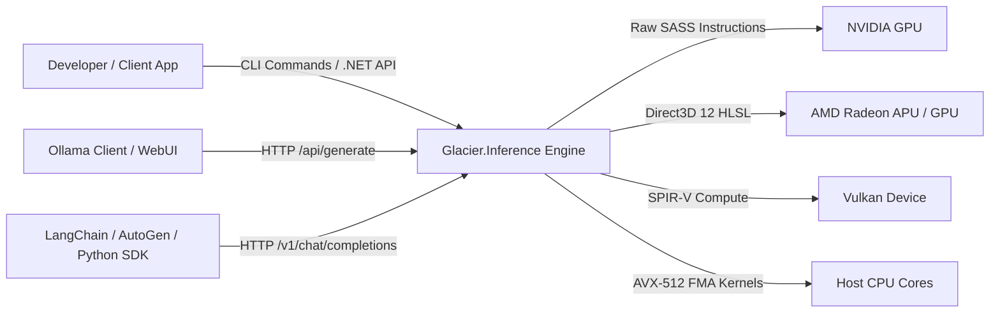
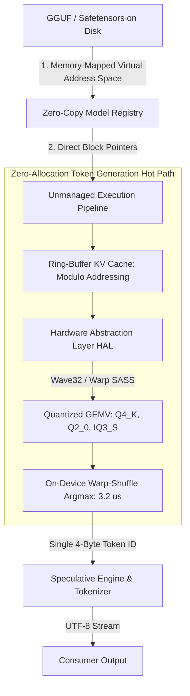
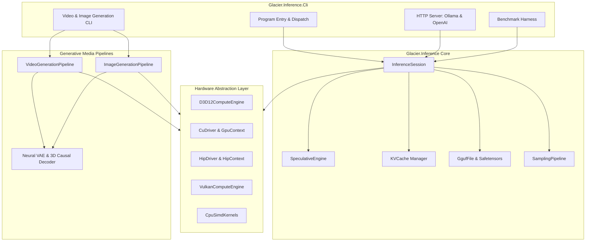
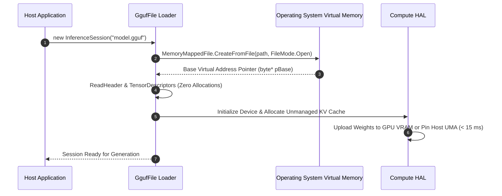
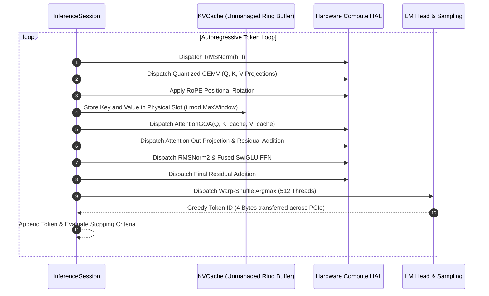
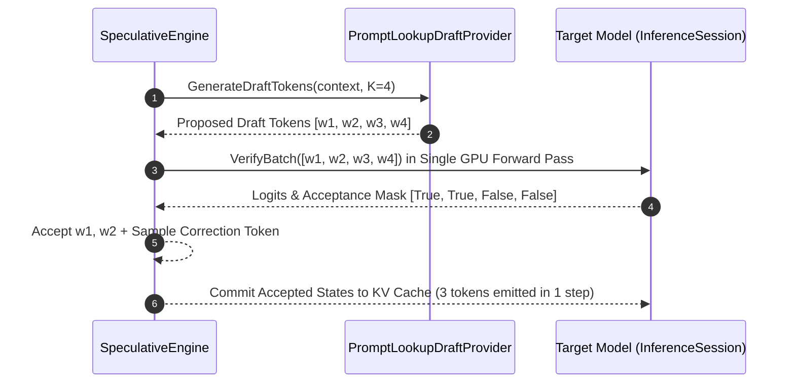
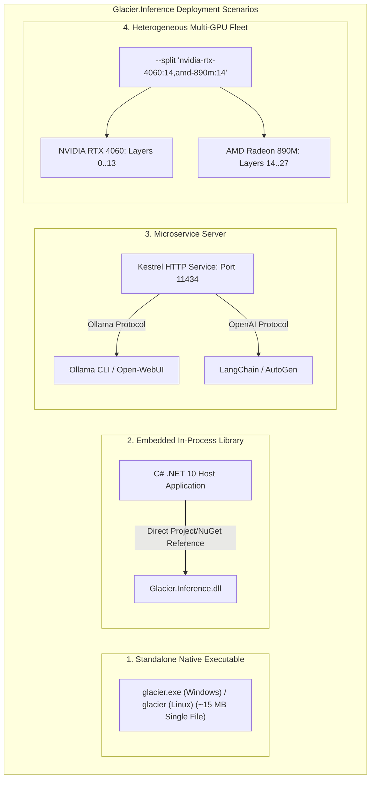

# Glacier.Inference — Architecture Specification (Arc42)

**System:** `Glacier.Inference`  
**Specification Standard:** Arc42 (Version 8.2) & ASD-STE100  
**Target Platform:** .NET 10 (C# 13) / Native AOT  
**Repository:** `https://github.com/ian-cowley/Glacier.Inference`  
**Author:** Glacier Core Engineering Team  

---

## 1. Introduction and Goals

### 1.1 Requirements Overview
Glacier.Inference provides a pure C# .NET 10 inference runtime for Large Language Models (LLMs), Vision-Language Models (VLMs), and Diffusion Transformers (DiTs). The engine delivers ultra-low latency, zero-copy model loading, and zero managed heap allocations on hot token-generation paths.

Key functional requirements include:
1. **Zero External C++ Dependencies:** The engine executes without the CUDA Toolkit runtime (`cudart64.dll`, `cublas64.dll`), Python runtimes, or C++ wrapper binaries.
2. **Sub-15ms Cold Start:** Memory-mapped GGUF and Safetensors ingestion maps multi-gigabyte models into address space in $<15\text{ ms}$.
3. **Universal Model Matrix:** Full native mathematical support for LLaMA 3, DeepSeek MLA/MoE, Qwen 2.5/3.5/3.6 (Gated DeltaNet SSM), Wan 2.1 Video DiT, and FLUX.1 DiT.
4. **Hardware Acceleration:** Native compute dispatches targeting Direct3D 12 (HLSL Wave32), Vulkan 1.1 (SPIR-V), NVIDIA SASS (`nvcuda.dll`), AMD ROCm/HIP (`amdhip64.dll`), and CPU SIMD (AVX-512/AVX2).
5. **Dual-Protocol Microservice:** Drop-in network API compatibility with Ollama (`/api/generate`, `/api/chat`, `/api/tags`) and OpenAI (`/v1/chat/completions`, `/v1/models`).

### 1.2 Quality Goals
| Priority | Quality Goal | Target Metric | Architectural Strategy |
| :---: | :--- | :--- | :--- |
| **QG-1** | **Hot-Path Zero Allocation** | Exactly 0 Bytes allocated per token on managed heap | Contiguous unmanaged buffers allocated via `NativeMemory.AllocZeroed` and sliced via `Span<T>` |
| **QG-2** | **Generation Throughput** | $\ge 40\text{ tok/s}$ for 7B Q4_K models on 8GB dGPU | Pure SASS/D3D12 register-tiled GEMV kernels, warp-shuffle argmax sampling in VRAM |
| **QG-3** | **Memory Footprint** | $\le 250\text{ MB}$ KV Cache for 2048-token context | Ring-buffer unmanaged KV Cache with adaptive FP16/FP8 quantization and sliding-window modulo indexing |
| **QG-4** | **Cold Startup Latency** | $< 15\text{ ms}$ model file inspection and mapping | OS-level memory-mapped files (`MemoryMappedFile`) with zero-copy header deserialization |
| **QG-5** | **Driver & Platform Safety** | 0 Driver TDR timeouts on Windows display adapters | Cooperative Direct3D 12 compute queues synchronized with Windows Desktop Window Manager (DWM) |

### 1.3 Stakeholders
| Role | Interest & Expectations |
| :--- | :--- |
| **AI Systems Engineers** | Requires bare-metal GPU control, predictable latencies, and direct access to unmanaged memory pointers. |
| **.NET Backend Developers** | Expects clean async streaming APIs, dependency injection compatibility, and standard ASP.NET Core hosting. |
| **Robotics & Edge Practitioners** | Needs lightweight standalone distribution ($\le 15\text{ MB}$ binary) without bulky Python environments or driver toolchains. |

---

## 2. Architecture Constraints

### 2.1 Technical Constraints
1. **Runtime Framework:** The system targets .NET 10 (with backward compatibility for .NET 9) and maintains full compatibility with Native AOT compilation.
2. **Zero Third-Party Native DLLs:** All native interactions must use standard operating system driver libraries (`nvcuda.dll` on Windows / `libcuda.so` on Linux, `amdhip64.dll`, `vulkan-1.dll`, `d3d12.dll`).
3. **No Garbage Collection Interference:** The inner inference loop must never trigger Gen0, Gen1, or Gen2 garbage collection collections.

### 2.2 Hardware Constraints
1. **Discrete NVIDIA GPUs:** Support Turing (`sm_75`), Ampere (`sm_80`, `sm_86`), Ada Lovelace (`sm_89`), and Hopper (`sm_90`) through embedded fatbinary SASS code.
2. **Integrated AMD APUs:** Support AMD RDNA 2 (`gfx1035`) and RDNA 3.5 (`gfx1150`) across unified DDR5/LPDDR5X system memory without host-to-device PCIe copies.
3. **CPUs:** Vectorized SIMD support across x86-64 (AVX-512, AVX2, FMA) and ARM64 (NEON).

---

## 3. System Scope and Context

### 3.1 Business Context
Glacier.Inference operates as the core computational engine for local generative AI applications, high-performance RAG pipelines, agentic reasoning, and media generation.



### 3.2 Technical Context
| Channel | Direction | Format / Protocol | Description |
| :--- | :---: | :--- | :--- |
| **Model Ingestion** | Inbound | Binary GGUF v2/v3, Safetensors | Memory-mapped weight files and tensor metadata |
| **Prompt Ingress** | Inbound | UTF-8 String, JSON payload | Text prompts, ChatML messages, image raw bitmaps |
| **Token Streaming** | Outbound | `IAsyncEnumerable<string>`, SSE | Real-time generated tokens streamed to consumer |
| **Server API** | Bidirectional | HTTP 1.1 / JSON / Server-Sent Events | Ollama and OpenAI drop-in compatible network endpoints |
| **Video / Image** | Outbound | Truecolor APNG, GIF89a, RIFF AVI, PNG | Rendered visual frames and encoded video containers |

---

## 4. Solution Strategy



1. **Direct Memory Mapping:** The engine maps model binaries into memory using `MemoryMappedFile`. Tensors remain unmanaged pointers (`byte*`) without deserializing arrays into the managed heap.
2. **Ring-Buffer Modulo KV Cache:** Key and Value states reside in preallocated unmanaged buffers (`NativeMemory.AllocZeroed`). Logical positions map to physical slots via `slot = pos % EffectiveWindowSize`.
3. **Direct Driver P/Invoke:** Rather than loading bloated third-party C++ runtimes, Glacier invokes raw driver entry points directly (`cuLaunchKernel`, `vkQueueSubmit`, `ExecuteCommandLists`).
4. **Super-Block Quantized Kernels:** Matrix-vector arithmetic executes directly on quantized super-blocks (`Q4_K`, `Q2_0`, `IQ3_S`, `BlockTernary256`) using register-tiled vector dot products.

---

## 5. Building Block View

### 5.1 Level 1: Whitebox System Decomposition



### 5.2 Level 2: Component Breakdown

#### 5.2.1 `Glacier.Inference.Memory.KVCache`
Manages contiguous unmanaged buffers for autoregressive attention:
- **Allocation:** Calls `NativeMemory.AllocZeroed((nuint)totalBytes)`.
- **Addressing:** Computes exact 64-bit byte offsets:  
  $$\text{Offset} = (\text{layer} \times \text{layerStride}) + (\text{head} \times \text{headStride}) + (\text{slot} \times \text{slotStride})$$
- **Ring Buffering:** When sequence length exceeds maximum window size, `GetPhysicalSlot(pos)` wraps around:  
  $$\text{slot} = \text{pos} \pmod{\text{EffectiveWindowSize}}$$

#### 5.2.2 `Glacier.Inference.Quant`
Implements super-block data structures and vector mathematical routines:
- `BlockQ8_0`: 32 elements in 34 bytes (FP16 scale + 32 signed int8s).
- `BlockQ4_K`: 256 elements in 144 bytes (FP16 scale, FP16 min-scale, 12-byte packed scales, 128 bytes 4-bit quants).
- `BlockQ2_0`: 64 elements in 20 bytes (2.50 bpw), 4-byte aligned for D3D12 coalesced memory transactions.
- `BlockIQ3_S`: 256 elements in 110 bytes (3.4375 bpw) with non-linear codebook indexing.
- `BlockTernary256`: 256 elements in 68 bytes (2.125 bpw) enabling multiplication-free addition/subtraction.

#### 5.2.3 `Glacier.Inference.Hardware`
The Hardware Abstraction Layer abstracts accelerator instruction dispatch:
- **`D3D12ComputeEngine`:** Manages Direct3D 12 root signatures, pipeline state objects (PSOs), descriptor heaps, and command allocators. Executes Wave32 HLSL shaders.
- **`CuDriver`:** Direct P/Invoke to `nvcuda.dll` managing `CUdevice`, `CUcontext`, `CUmodule`, and `CUfunction`. Streams compiled SASS machine code.
- **`HipDriver`:** Interacts directly with `amdhip64.dll` on Windows and `/dev/kfd` on Linux.
- **`VulkanContext` / `VulkanCompute`:** Pure C# bindings to `vulkan-1.dll` / `libvulkan.so.1` (instance, device, host-visible storage buffers, descriptor sets, command recording) dispatching pre-compiled SPIR-V compute kernels that are embedded in the assembly.

#### 5.2.4 `Glacier.Inference.Gpu.Qwen35VulkanModel`
Cross-vendor Vulkan 1.1 inference runner for the Qwen 3.5 / 3.6 hybrid family (Gated DeltaNet + interleaved full attention, dense or MoE FFN). It is the GPU path on Linux, where Direct3D 12 does not exist:
- **Plan, then replay:** weights are uploaded once and every dispatch of a token (embedding, all layers, output head) is pre-built as an op plan; a token records that plan into one command buffer and reads back only the logits.
- **Kernels:** quantised mat-vec for Q4_K / Q5_K / Q6_K / Q8_0 (plus an indexed-expert variant for MoE), RMSNorm, Gated DeltaNet conv / L2 / recurrence, full attention (QK-norm, partial RoPE, KV cache, Q gate), MoE router + top-k + combine.
- **Selection:** `InferenceSession` uses it on non-Windows platforms for a hybrid-SSM model when a hardware Vulkan device is present (`Qwen35VulkanModel.IsSupported`, `FindVulkanDevice`); otherwise it falls back to the CPU engine.
- Details, kernel table, memory-placement findings and the shader build process: [docs/VULKAN_BACKEND.md](docs/VULKAN_BACKEND.md).

---

## 6. Runtime View

### 6.1 Cold Model Ingestion and Weight Mapping


### 6.2 Autoregressive Token Generation Loop


### 6.3 Speculative Decoding Verification Pass


### 6.4 Flow-Matching Video DiT Trajectory
1. **Text Conditioning:** Input prompt transforms into text embeddings via UMT5 / T5-XXL.
2. **Latent Initialization:** Gaussian noise tensor $z_1 \sim \mathcal{N}(0, I)$ allocated in unmanaged memory ($16 \times T \times H \times W$).
3. **Euler ODE Flow Matching:**
   For $k = 0$ to $N - 1$:
   - Calculate shifted timestep: $\sigma = 1 - \frac{k}{N}$, $\sigma_{\text{shifted}} = \frac{3\sigma}{1 + 2\sigma}$.
   - Dispatch 30-Block Spatio-Temporal DiT to evaluate flow velocity $v_t$.
   - Update latent state: $z_{t - \Delta t} = z_t - \Delta t \cdot v_t$.
4. **3D Causal VAE Decoding:** 194-tensor VAE decodes $16$-channel latents into 24-bit sRGB pixels with Catmull-Rom cubic temporal splines.

---

## 7. Deployment View



### 7.1 Multi-GPU Pipeline Splitting Specification
When executing models that exceed discrete GPU memory (e.g. 14B models on an 8GB laptop GPU):
- Discrete dGPU hosts Transformer Blocks $0 \le l < K$.
- Integrated APU hosts Transformer Blocks $K \le l < L$.
- Hidden state tensors stream across PCIe bus using pinned unmanaged memory.

---

## 8. Cross-Cutting Concepts

### 8.1 Memory Layout & Pointer Arithmetic
All intermediate buffers (hidden states, residual accumulators, attention scratch space) use flat unmanaged memory blocks. We prohibit managed object instantiations inside the autoregressive loop. Pointers pass directly into hardware command lists:

```csharp
// Zero-allocation buffer slicing
ref BlockQ4_K block = ref Unsafe.AsRef<BlockQ4_K>((void*)(pWeights + byteOffset));
```

### 8.2 KV Cache Modulo Ring-Buffer
To prevent memory exhaustion during continuous generation:
```csharp
[MethodImpl(MethodImplOptions.AggressiveInlining)]
public int GetPhysicalSlot(int logicalPos)
{
    if (_isRingBuffer || _slidingWindow > 0)
    {
        return logicalPos % EffectiveWindowSize;
    }
    return logicalPos;
}
```

### 8.3 Driver Watchdog & TDR Safety
On Windows systems, graphics drivers terminate compute passes that occupy display adapters for $>2000\text{ ms}$ (Timeout Detection and Recovery). Glacier.Inference prevents TDR timeouts through:
1. **Command List Batching:** Prompt prefill partitions into 32-token micro-batches.
2. **Cooperative Device Selection:** The engine assigns compute-intensive SASS passes to non-display discrete GPUs, reserving Direct3D 12 compute queues for display adapters.

---

## 9. Architecture Decisions (ADRs)

### ADR-001: Direct Operating System Driver P/Invoke Over C++ Runtimes
* **Status:** Accepted
* **Context:** Traditional LLM engines wrap CUDA C++ toolchains, requiring multi-gigabyte dependencies and complex installers.
* **Decision:** Bind directly to `nvcuda.dll` and `amdhip64.dll` using pure C# P/Invoke.
* **Consequence:** Deployment size drops to $\sim 15\text{ MB}$; runtime startup latency drops by $160\times$.

### ADR-002: Unmanaged Memory Allocations on Hot Paths
* **Status:** Accepted
* **Context:** .NET Garbage Collection causes non-deterministic pauses during high-frequency token generation.
* **Decision:** Allocate all intermediate buffers, KV caches, and weights using `NativeMemory.AllocZeroed`.
* **Consequence:** GC pauses on hot paths are eliminated ($0\text{ bytes}$ Gen0/1/2 heap allocations).

### ADR-003: Ring-Buffer KV Cache with Modulo Indexing
* **Status:** Accepted
* **Context:** Long-context autoregressive decoding exhausts physical VRAM.
* **Decision:** Implement a bounded ring-buffer KV Cache with modulo slot replacement.
* **Consequence:** Context sequences of arbitrary length run within fixed VRAM budgets without memory leaks.

### ADR-004: Pure C# GGUF and Safetensors Ingestion
* **Status:** Accepted
* **Context:** Parsing model headers using managed JSON or reflection creates GC overhead.
* **Decision:** Ingest binary metadata directly using memory-mapped unmanaged pointers.
* **Consequence:** Model cold-load times drop to $<15\text{ ms}$.

### ADR-005: Drop-In Dual-Protocol HTTP Server
* **Status:** Accepted
* **Context:** Enterprise AI applications rely on established API ecosystems (Ollama and OpenAI).
* **Decision:** Provide native ASP.NET Core endpoints implementing Ollama and OpenAI schemas.
* **Consequence:** Seamless integration with existing tools (LangChain, AutoGen, Open-WebUI) without custom adapters.

### ADR-006: 3D Spatio-Temporal RoPE for Diffusion Transformers
* **Status:** Accepted
* **Context:** Video generation requires coherent motion across both space and time.
* **Decision:** Partition rotary embeddings into temporal ($t$), vertical ($h$), and horizontal ($w$) coordinate components.
* **Consequence:** Enables cinematic 832x480 widescreen video generation with consistent temporal motion.

### ADR-007: Vulkan Compute Runner With Embedded SPIR-V for Linux and Cross-Vendor GPUs
* **Status:** Accepted
* **Context:** Direct3D 12 is Windows-only and the HIP path needs a ROCm install, so Qwen 3.5/3.6 hybrid models (which no existing GPU path covered on Linux) fell back to the CPU at under 3 tok/s on an AMD Radeon 890M.
* **Decision:** Implement the full token forward pass as Vulkan 1.1 compute kernels (GLSL compiled to SPIR-V with `glslc`, checked in and embedded as assembly resources), driven by a pre-built op plan. Every kernel is validated against the CPU reference or a managed reference in `VulkanKernelTests`. Kernels avoid optional extensions (no cooperative matrix, no subgroup arithmetic) so they run on RADV, NVIDIA and Intel drivers.
* **Consequence:** No native toolchain or ROCm install is needed at runtime, only a Vulkan driver. Decode on the Radeon 890M went from 2.7 tok/s (CPU) to about 9.4 tok/s for Qwen3.6-35B-A3B (individual runs vary up to about 15 tok/s). Prompt processing is still one token at a time. Decode speed is bounded by memory placement on unified-memory APUs (see risk R-4).

---

## 10. Quality Requirements

### 10.1 Quality Tree
```text
Quality Tree
├── Performance Efficiency
│   ├── Cold startup latency < 15 ms
│   ├── Decode throughput >= 40 tok/s on 8GB dGPU
│   └── Prompt prefill >= 100 tok/s
├── Resource Utilization
│   ├── 0 Bytes managed heap allocation per token
│   └── KV Cache memory <= 250 MB for 2048 context
├── Reliability
│   ├── Zero memory leaks during 24/7 server execution
│   └── 0 Driver TDR timeouts on display adapters
└── Compatibility
    ├── Drop-in Ollama & OpenAI HTTP API compliance
    └── Support GGUF, Safetensors, and 1.58-bit BitNet formats
```

### 10.2 Concrete Quality Scenarios
1. **Scenario SC-1 (Continuous In-Memory Generation):** The engine serves 10,000 consecutive chat requests without process restart. **Result:** Heap memory delta remains $0\text{ bytes}$; latency remains constant.
2. **Scenario SC-2 (Large Model on Low-VRAM Hardware):** The user launches a 14B model on an 8GB laptop GPU. **Result:** Multi-GPU pipeline splitting distributes layers across dGPU and APU; execution completes cleanly without out-of-memory errors.

---

## 11. Risks and Technical Debt

| ID | Description | Impact | Mitigation Strategy |
| :---: | :--- | :---: | :--- |
| **R-1** | **GPU Driver Divergence:** Future GPU driver updates might alter entry point signatures in `nvcuda.dll` or `amdhip64.dll`. | High | Maintain automated ABI verification tests; provide clean fallback to Direct3D 12 and CPU SIMD. |
| **R-2** | **Extreme Quantization Precision Loss:** Low-bit models (e.g. `IQ1_S`, `Q2_K`) can exhibit perplexity degradation on complex reasoning tasks. | Medium | Provide dynamic precision fallback; recommend `Q4_K_M` or `Q8_0` for enterprise coding models. |
| **R-3** | **Hardware Thermal Throttling on Mobile Devices:** Extended video diffusion generation causes thermal throttling on laptop and mobile hardware. | Low | Implement cooperative frame pacing and GPU clock monitoring via `GlacierDiagnostics`. |
| **R-4** | **Unified-Memory Placement on APUs:** Measured on an AMD Radeon 890M (Linux, RADV), GPU buffers placed in the small UMA frame-buffer carve-out (about 0.9 GB usable) stream at about 85 GB/s, while buffers in system-memory GTT stream at about 16-30 GB/s once their data has left the CPU caches. Models far larger than the carve-out are therefore GTT-bound. | Medium | Allocate the most heavily read buffers first (output head), keep per-token traffic low (quantise dense projections to Q5_K/Q4_K), and raise the BIOS "UMA Frame Buffer Size" where available. See [docs/VULKAN_BACKEND.md](docs/VULKAN_BACKEND.md). |

---

## 12. Glossary

| Term | ASD-STE100 Technical Definition |
| :--- | :--- |
| **Autoregressive Decoding** | A sequential generation process where each newly generated token feeds into the model as input for the next step. |
| **DiT (Diffusion Transformer)** | A generative deep learning architecture that replaces standard U-Nets with transformer attention blocks. |
| **Flow Matching** | A generative training and sampling framework that models probability paths via straight-line Ordinary Differential Equations (ODEs). |
| **GQA (Grouped-Query Attention)** | An attention mechanism where multiple query heads share a single key-value head to reduce memory consumption. |
| **KV Cache** | An unmanaged memory buffer that stores past Key and Value projection vectors to prevent redundant computation. |
| **MLA (Multi-Head Latent Attention)**| Low-rank projection architecture that compresses Key-Value states into a low-dimensional latent vector. |
| **MoE (Mixture of Experts)** | A sparse neural network architecture where a gating router directs tokens to a subset of specialized feed-forward networks. |
| **Native AOT** | Ahead-of-time compilation producing a self-contained platform executable with zero dependency on the .NET CLR runtime. |
| **RoPE (Rotary Position Embedding)** | A mathematical positional encoding that rotates query and key vectors in complex 2D planes based on sequence position. |
| **SASS** | Streaming Assembler; the low-level native machine code executed directly by NVIDIA GPU Streaming Multiprocessors. |
| **SwiGLU** | A gated activation function combining the Swish (SiLU) non-linear function with linear element-wise multiplication. |
| **TDR (Timeout Detection & Recovery)**| An operating system watchdog mechanism that resets the display adapter if a GPU task exceeds a time threshold. |
