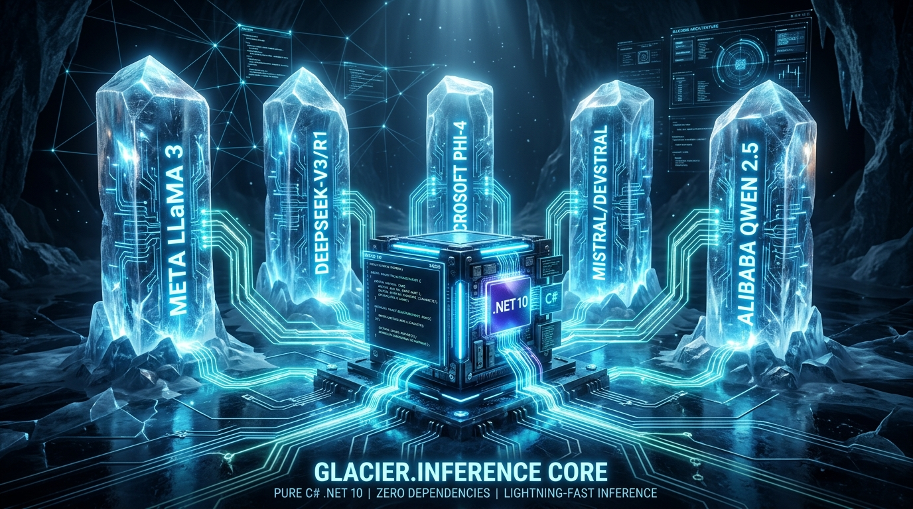

# Glacier.Inference

[](LICENSE)
[](https://dotnet.microsoft.com/)
[](https://learn.microsoft.com/dotnet/core/deploying/native-aot/)
[](https://www.nuget.org/packages/Glacier.Inference/)

`Glacier.Inference` is a local AI inference runtime, standalone CLI (`glacier`), and OpenAI/Ollama-compatible HTTP server written in pure C# for .NET 10.

If you want to run open-weight LLMs, embeddings, image generation, video synthesis, or local text-to-speech on Windows, Linux, or Android—or embed model execution directly inside a C# app without installing Python, PyTorch, or the CUDA Toolkit—`Glacier.Inference` handles model loading and hardware acceleration in-process by calling your installed OS GPU drivers (`nvcuda.dll`, `d3d12.dll`, Vulkan, AMD HIP) or multi-core CPU SIMD.

## Install

```bash
# Embed inside a C# application
dotnet add package Glacier.Inference

# Install the CLI tool globally
dotnet tool install --global Glacier.Inference.Cli
```

## Quick Start

### Stream Tokens From C#

```csharp
using Glacier.Inference.Engine;
using Glacier.Inference.Sampling;

using var session = new InferenceSession("Meta-Llama-3.1-8B-Instruct-Q4_K_M.gguf");

var options = new SamplingOptions
{
    Temperature = 0.7f,
    TopP = 0.9f,
    MaxTokens = 128
};

await session.GenerateAsync("Explain quicksort in C#.", options, onToken: token =>
{
    Console.Write(token);
});
```

### Run or Serve From the Terminal

```bash
glacier devices
glacier run "models/Meta-Llama-3.1-8B-Instruct-Q4_K_M.gguf" "Explain quicksort in C#."
glacier serve "models/Meta-Llama-3.1-8B-Instruct-Q4_K_M.gguf" --port 11434 --host 127.0.0.1
```

## What You Can Do

| Workload | Supported Models & Formats (GGUF / Safetensors) |
| :--- | :--- |
| **Chat & Reasoning LLMs** | Llama 3 / 3.1 / 3.2 / 3.3, DeepSeek-V2 / V3 / R1, Qwen 2.5 / 3 / 3.5 / 3.6 / 3.8 (`TRL1..TRL6`), Gemma 4, Phi-3 / Phi-4, Mistral / Devstral |
| **OpenAI & Ollama API Server** | Drop-in `/v1/chat/completions`, `/v1/completions`, `/v1/models`, `/api/chat`, `/api/generate`, `/api/tags` with optional `GLACIER_API_KEY` auth |
| **Multimodal Embeddings** | EmbeddingGemma 2 (`EmbeddingGemma2Model`) across text, audio, image, and video inputs |
| **Image & Video Generation** | FLUX.1 Schnell/Dev diffusion (`glacier image`) and Wan 2.1 video synthesis to APNG/GIF/AVI (`glacier video`) |
| **Speech Synthesis & STT** | KittenTTS neural speech synthesis, Kokoro acoustic formant TTS, and OpenAI-compatible Whisper STT (`glacier voice`) |

## Platform & Compatibility

- Targets Windows, Linux, and Android on `.NET 10`, with Native AOT support and zero external C++ runtime installers.
- Automatically selects NVIDIA CUDA (`nvcuda.dll` / `libcuda.so.1`), Direct3D 12 (Windows), Vulkan 1.1/1.3, AMD HIP (`amdhip64.dll` / `/dev/kfd`), multi-GPU `--split`, or AVX-512 / AVX2 / ARM64 NEON CPU SIMD.
- On Linux and other non-Windows systems, the Vulkan runner accelerates hybrid Qwen 3.5/3.6 models with `Q4_K`, `Q5_K`, `Q6_K`, or `Q8_0` weights; unsupported weight formats (such as `IQ4_XS`) log a diagnostic message and fall back to CPU execution.

## Benchmarks

All numbers below come from executed runs on physical hardware (no simulated steps or approximations):

| Workload | Hardware & Backend | Measured Result | Details |
| :--- | :--- | ---: | :--- |
| `Qwen2.5-7B-Instruct` (`Q4_K_M`) | RTX 4060 8 GB (CUDA SASS) | **106.71 tok/s** pp / **42.90–64.05 tok/s** tg | [benchmarks.md](docs/benchmarks.md) |
| `Qwen3-4B-Instruct-2507` (`Q4_K_M`) | RTX 3060 12 GB (CUDA Graph ON) | **114.18 tok/s** pp / **71.03 tok/s** tg | [benchmarks.md](docs/benchmarks.md) |
| `Qwen3.8-27B-NariQ` (`2.5bpw`) | RTX 3060 12 GB (CUDA / Vulkan) | **19.1–19.2 tok/s** live (CUDA) / **8.8 tok/s** (Vulkan) | [benchmarks.md](docs/benchmarks.md) |
| `Gemma-4-26B-A4B-it` (`Q4_K_M`, MoE) | Radeon 890M 64 GB Linux (Vulkan) | **285.41 tok/s** pp / **29.00 tok/s** tg | [benchmarks.md](docs/benchmarks.md) |
| `Qwen3.6-35B-A3B-UD` (`Q4_K_M`) | Radeon 890M 64 GB Linux (Vulkan vs CPU) | **9.4 tok/s** (Vulkan) vs **2.7 tok/s** (24T CPU) | [VULKAN_BACKEND.md](docs/VULKAN_BACKEND.md) |
| `VecDotF32` / `VecDotQ4_K` / `VecDotQ8_0` (`Dim=3584`) | Ryzen AI 9 HX 370 (`.NET 10.0.15`) | **137.6 ns** / **425.2 ns** / **353.6 ns** (`0 B` alloc) | `SimdDotBenchmarks` |
| `MatVecMul_Q4_K` / `MatVecMul_Q8_0` (`3584x3584`) | Ryzen AI 9 HX 370 (`.NET 10.0.15`) | **284.3 us** / **245.5 us** | `GemvBenchmarks` |

Reproduce CPU microbenchmarks locally:

```bash
dotnet run --project benchmarks/Glacier.Inference.Benchmarks/Glacier.Inference.Benchmarks.csproj -c Release -- --job short --filter *
```

## Documentation

- [User Manual](docs/manual.md) — installation options, full C# & CLI reference, HTTP server auth, `--split` multi-GPU, VRAM sizing, image/video/voice, systemd setup, and troubleshooting
- [Architecture](docs/architecture.md) — memory-mapped loading, ring-buffer KV cache, quantization blocks, HAL backends, and ADRs
- [Benchmarks](docs/benchmarks.md) — cross-machine physical runs, multimodal VAE timings, and BenchmarkDotNet tables
- [Vulkan Backend Notes](docs/VULKAN_BACKEND.md) — Linux RADV kernel pipeline, memory placement constraints, and re-quantization measurements
- [MLA Decoupled RoPE](docs/explanation/mla_decoupled_rope.md) & [YaRN RoPE Scaling](docs/explanation/yarn_rope_scaling.md) — positional encoding specs
- [Chat Formatting Protocols](docs/reference/chat_formatting_protocols.md) — ChatML and model template rules
- [Changelog](CHANGELOG.md) — release history

## License & Credits

Licensed under the [MIT License](LICENSE).

Developed by Ian Cowley, Antigravity (Google DeepMind) and Claude.
