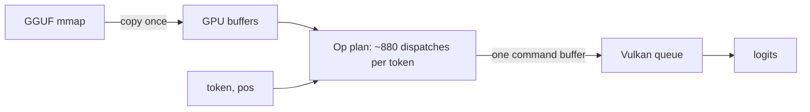

# Vulkan Compute Backend (Qwen 3.5 / 3.6 hybrid models)

Glacier.Inference runs the Qwen 3.5 / 3.6 hybrid family (Gated DeltaNet + interleaved full attention, dense or
Mixture-of-Experts FFN) on any **Vulkan 1.1** GPU through `Qwen35VulkanModel`. It is the GPU path on **Linux**, where
Direct3D 12 does not exist, and it needs only a Vulkan driver at runtime: no ROCm, no CUDA toolkit, no native
libraries.

| | |
| :--- | :--- |
| Entry point | `InferenceSession` selects it automatically (non-Windows, hardware Vulkan device, hybrid-SSM model); `--engine vulkan` forces the engine choice |
| Source | `src/Glacier.Inference/Gpu/Vulkan/` (`Qwen35VulkanModel.cs`, `VulkanCompute.cs`) and `Shaders/*.comp` |
| Tests | `tests/Glacier.Inference.Tests/VulkanKernelTests.cs` (skipped when no hardware Vulkan device is present) |
| Windows | Windows keeps using the Direct3D 12 path; the Vulkan runner is not selected there |

## 1. What is supported

* **Architectures:** models for which `ModelWeights.IsHybridSsm` is true and that satisfy `Qwen35VulkanModel.IsSupported`:
  attention head dim 256, SSM state size 128, conv kernel 4, `ssm_time_step_rank * 128 == ssm_inner_size`, full-attention
  layers with a Q gate, no attention biases, no custom RoPE frequency table. `ssm_alpha` / `ssm_beta` may be F32 or any supported
  quantisation type (quantised ones are dequantised on the host at upload; they are tiny).
  Dense and MoE (with shared expert and sigmoid shared-expert gate) FFNs are both implemented.
* **Weight types:** `Q4_K`, `Q5_K`, `Q6_K`, `Q8_0` for every weight matrix, the token embedding and the output head. A file that
  contains any other weight type (for example the `IQ4_XS` tensors in `Qwen3.6-27B-UD-Q4_K_XL`) is rejected **before any GPU
  memory is allocated**; the reason is logged and the CPU engine is used.
* **Not implemented yet:** batched GPU prefill (prompt tokens are processed one at a time), cooperative-matrix kernels,
  other quantisation types, multi-GPU pipeline splitting for this runner, and KV-cache precisions other than FP32.

## 2. How it works



1. **Upload.** Weights are copied from the memory-mapped GGUF into host-visible storage buffers. On a unified-memory APU
   this memory is directly visible to the GPU.
2. **Plan.** Every dispatch of a token (embedding gather, all layers, output head) is built once as an `Op` (kernel,
   descriptor set, push constants, grid). Only `pos`, `kvLen` and `token` are patched per token.
3. **Replay.** A token records the whole plan into one command buffer (about 0.3 ms of CPU time), submits it and waits.
   Only the logits (`vocab * 4` bytes) are read back, and only when requested (prompt tokens skip the output head).

### Kernels (GLSL, `Shaders/`)

| Shader | Purpose |
| :--- | :--- |
| `qmatvec.comp` (`-DQTYPE=0..3`, optional `-DMOE`) | Mat-vec for Q4_K / Q5_K / Q6_K / Q8_0; MoE variant takes the expert index from a GPU buffer |
| `embed.comp` | Embedding row gather and dequantisation |
| `f32_matvec.comp` | F32 mat-vec (`ssm_alpha`, `ssm_beta`, MoE router) |
| `rmsnorm.comp` | RMSNorm over rows (hidden state, per-head norms, QK-norm) |
| `elementwise.comp` | SwiGLU and residual add |
| `gdn_conv.comp`, `gdn_l2.comp`, `gdn_rec.comp` | Gated DeltaNet causal conv + SiLU, Q/K L2 norm, delta-rule state update |
| `attn_prep.comp`, `attn_decode.comp` | Q/gate split, QK-norm, partial NeoX RoPE, KV store; softmax attention with Q gate |
| `moe_topk.comp`, `moe_combine.comp` | Softmax + parallel top-K routing; weighted expert sum, shared expert and residual |

Notes that matter when changing kernels:

* **V-head to Q/K-head mapping is tiled** (`g = h % nK`), as in llama.cpp, not grouped (`h / ratio`). The CPU model and
  the D3D12 shader had the grouped mapping, which produced garbage text for Qwen 3.5/3.6 whenever `nV > nK`; both are fixed.
* The recurrent state is stored **transposed** on the GPU (`St[j*128 + i]`) so adjacent threads read adjacent memory.
* `qmatvec` uses `vec4` input loads and one 32-bit weight load per thread; Q6_K and Q8_0 blocks are only 2-byte aligned and
  use funnel-shifted 32-bit loads.
* Kernels use no optional extensions (no cooperative matrix, no subgroup arithmetic), so they run on RADV, NVIDIA and
  Intel drivers.

### Rebuilding the shaders

The SPIR-V is checked in and embedded as assembly resources (`vkshader.<name>.spv`), so **building the library does not need
a shader compiler**. After editing any `.comp` / `.glsl` file, regenerate the binaries and commit them with the source:

```bash
cd src/Glacier.Inference/Gpu/Vulkan/Shaders
bash build_shaders.sh        # needs glslc (Vulkan SDK, or the `glslc` package on Linux)
```

## 3. Validation

`VulkanKernelTests` runs the real embedded kernels at small sizes and compares them with the CPU `QuantKernels` or a managed
reference: all four quantised mat-vecs, the MoE FFN chain (router, experts, shared expert, combine), a multi-token Gated
DeltaNet sequence with `nV / nK = 2` (so the tiled mapping is exercised), and multi-position attention with a growing KV
cache. The tests pass on the AMD Radeon 890M under Linux/RADV and on the Windows development laptop, and skip when no
hardware Vulkan device exists.

End to end, with greedy decoding (`--temp 0`, 40 tokens, same prompt) the Vulkan runner produced **token-identical output to
the CPU engine** for both Qwen3.6-35B-A3B (MoE FFN) and Qwen3.5-4B (dense FFN), on the Radeon 890M under RADV.

## 4. Measured performance

All numbers below come from **one machine**: Ryzen AI 9 HX 370, Radeon 890M (`gfx1150`, RADV), 62 GB LPDDR5X,
Fedora 43, 1 GB UMA frame-buffer carve-out, `amdgpu.gttsize=53248`. Qwen3.6-35B-A3B (`UD-Q4_K_M`, 20.6 GiB), decode only.

| Engine | Decode (tok/s) |
| :--- | :---: |
| Glacier CPU engine (24 threads, AVX-512) | 2.7 |
| **Glacier Vulkan runner** (3 runs, 30 tokens each) | **9.4** (9.2 to 9.6) |
| llama.cpp Vulkan, same file (`llama-bench tg64`) | 10.4 |

Run-to-run variation is real on this machine: individual CLI runs of the same build and file reported between 9.4 and 15.2 tok/s,
and one profiling run reached 49.7 ms/token (about 20 tok/s) that could not be reproduced. The 9.4 tok/s figure is the typical
steady result of the interleaved three-run benchmark; see section 5 for what is and is not understood about the variation.

Dense model, single CLI run each (Qwen3.5-4B `Q4_K_M`, 2.7 GB): CPU engine 1.9 tok/s, Vulkan runner 21.8 tok/s.

Prompt processing is token-at-a-time (no batched prefill); llama.cpp reaches about 169 tok/s on `pp128`.

Isolated mat-vec bandwidth after tuning (K=2048, N=32768, random weights, correctness-checked against the CPU):
Q4_K 78 GB/s, Q5_K 90 GB/s, Q6_K 81 GB/s, Q8_0 87 GB/s.

### Quantising the dense projections (optional)

The `UD-Q4_K_M` file keeps the GDN / attention / shared-expert projections in Q8_0. They are only 7% of the file but about 58%
of the bytes read per token (all experts together are 88% of the file, yet only 8 of 256 are read per token). Re-quantising
just those 250 tensors with `llama-quantize --allow-requantize --tensor-type-file` (base type `Q5_K_S`, which does not bump
other tensors) gave:

| Projections | File | Glacier Vulkan decode | Mean KLD vs original | Perplexity | Top-1 agreement |
| :--- | :---: | :---: | :---: | :---: | :---: |
| Q8_0 (original) | 22.1 GB | 9.4 tok/s | baseline | 8.526 | baseline |
| **Q5_K** | 21.6 GB | **12.3 tok/s** (+31%) | 0.0149 | 8.561 (+0.4%) | 94.0% |
| Q4_K | 21.4 GB | 13.0 tok/s (+38%) | 0.0367 | 8.651 (+1.5%) | 90.8% |

Quality was measured with `llama-perplexity --kl-divergence` on 12K tokens of English technical documentation, against the
original file as baseline (itself already quantised). It is a relative measure on one corpus, not a task evaluation. Q5_K is
the recommended trade-off.

## 5. Memory placement on unified-memory APUs

This is the dominant factor for decode speed once the kernels are tuned, and it is only partly understood.

* On the 890M, Vulkan exposes one 53 GiB heap, but the kernel places the **first ~0.9 GB** of GPU allocations in the BIOS
  UMA frame-buffer carve-out and everything after that in system-memory **GTT**.
* Measured with a Q8_0 mat-vec over 128 MB chunks: carve-out buffers read at **85-88 GB/s**; GTT buffers read at
  **16-30 GB/s** once their data is no longer hot in the CPU caches (right after the CPU writes them they read fast, which is
  why short synthetic benchmarks look much better than real decode).
* Real decode therefore tracks **bytes read per token from GTT**, which is why Q5_K/Q4_K projections speed it up in proportion
  to the bytes saved, and why the runner allocates the output head (read in full every token) first and the embedding table
  (one row per token) last.
* Things that were tested and made **no difference**: GPU clocks (about 2.8 GHz and 94% busy during decode), pre-committing buffer
  pages, evicting the page cache, host-cached logits memory, buffer count and size, a 20 GB resident footprint, and free-memory
  fragmentation (`/proc/buddyinfo`).
* **GTT memory type does not matter.** With the unified-heap option off, RADV exposes separate GTT types. The write-combined,
  non-snooped type and the cached, snooped type both read at the same slow steady-state speed, so cache-coherency (snooping) overhead
  is not the cause. Per 128 MB chunk the GTT speed is bimodal (mostly 15-17 GB/s, some chunks 50-78 GB/s), which points at how the
  pages of each allocation are laid out, not at coherence.
* **The IOMMU is not involved on the test machine.** The GPU's IOMMU group is `identity` (pass-through), so `amd_iommu=off` is
  expected to change nothing there. (Check yours with `cat /sys/kernel/iommu_groups/$(basename $(readlink /sys/class/drm/card1/device/iommu_group))/type`.)
* The `radv_enable_unified_heap_on_apu` driconf option hides the VRAM/GTT split (one heap, all types `DEVICE_LOCAL`); placement is then
  decided by the kernel: carve-out first, GTT after. Without the option, Vulkan reports a small `DEVICE_LOCAL` heap (VRAM) and a
  host-visible heap (GTT). Either way only the first ~0.9 GB of a 1 GB carve-out is usable for buffers.
* Open question: one run reached 49.7 ms/token (about 20 tok/s) and could not be reproduced, and some CLI runs reported up to
  15 tok/s while the interleaved benchmark consistently gave about 9.4 tok/s. The cause of the run-to-run variation is not
  identified.

**Practical advice:** the one lever that follows directly from the measurements is the BIOS *UMA Frame Buffer Size*. Look at which
sizes your BIOS offers (the available range differs between models; do not assume a particular maximum) and choose the largest that
leaves enough RAM for Linux and the page cache. The runner needs no change: the kernel fills the carve-out first, so more of the
weights land in the fast region. Check the result with `cat /sys/class/drm/card1/device/mem_info_vram_total` and, after loading a
model, `mem_info_vram_used` versus `mem_info_gtt_used`. This is **not verified** on a larger carve-out, because the test machine's
BIOS was not changed; if every weight fits in the carve-out, the expectation from the kernel benchmarks is a decode rate several
times higher than the GTT-bound figures above. Also prefer Q5_K/Q4_K projections where quality allows.

## 6. Diagnostics

* `Qwen35VulkanModel.ProfileReport()` prints per-kernel time per token (each op replayed back-to-back). Replays reuse the same
  pages, so use it for relative cost, not for absolute speed; real tokens are slower for memory-bound kernels.
* If the Vulkan runner is not used, the log line `[Vulkan GPU] Not used for this model: <reason>` says why (for example an
  unsupported weight type).
* `GlacierDiagnostics` logs per-layer upload progress and the number of dispatches per token.

## 7. Known limitations

* Prompt processing is one token at a time.
* Only Q4_K / Q5_K / Q6_K / Q8_0 weights; `IQ*`, `Q2_K`, `Q3_K`, `F16` weight matrices fall back to the CPU engine.
* Qwen3.6-27B `UD-Q4_K_XL` (contains `IQ4_XS`) therefore runs on the CPU engine.
* The context window is allocated up front (`--ctx`); the KV cache is FP32.
* Decode speed on APUs is bound by the memory placement behaviour described above.
