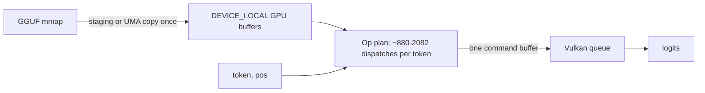

# Vulkan Compute Backend (Qwen 3.5 / 3.6 / 3.8 Hybrid & NariQ Models)

Glacier.Inference runs the Qwen 3.5 / 3.6 / 3.8 hybrid family (Gated DeltaNet + interleaved full attention, dense or
Mixture-of-Experts FFN, including NariQ `TRL1..TRL6` trellis-coded models) on any **Vulkan 1.3** or **Vulkan 1.1** GPU through `Qwen35VulkanModel`.
It is the primary GPU path on **Linux**, where Direct3D 12 does not exist, and also runs via `--engine vulkan` on Windows with only a Vulkan driver installed (no ROCm or CUDA toolkit).

| | |
| :--- | :--- |
| Entry point | `InferenceSession` selects it automatically (non-Windows, hardware Vulkan device, hybrid-SSM model); `--engine vulkan` forces the engine choice |
| Source | `src/Glacier.Inference/Gpu/Vulkan/` (`VulkanDriver.cs`, `VulkanContext.cs`, `VulkanRunnerBase.cs`, `TrellisVulkanRunner.cs`, `Qwen35VulkanModel.cs`) and `Shaders/*.spv` |
| Tests | `tests/Glacier.Inference.Tests/VulkanKernelTests.cs` & `NariQGpuParityTests.cs` (skipped when no hardware Vulkan device is present) |
| Windows | Windows keeps using Direct3D 12 or bare-metal CUDA by default; `--engine vulkan` runs the Vulkan runner on Windows GPUs too |

## 1. What is supported

* **Architectures:** models for which `ModelWeights.IsHybridSsm` is true and that satisfy `Qwen35VulkanModel.IsSupported`:
  attention head dim 256, SSM state size 128, conv kernel 4, `ssm_time_step_rank * 128 == ssm_inner_size`, full-attention
  layers with a Q gate, no attention biases, no custom RoPE frequency table. `ssm_alpha` / `ssm_beta` may be F32 or any supported
  quantisation type (quantised ones are dequantised on the host at upload; they are tiny).
  Dense and MoE (with shared expert and sigmoid shared-expert gate) FFNs are both implemented.
* **Weight types:**
  * Standard GGUF quants: `Q4_K`, `Q5_K`, `Q6_K`, `Q8_0` across matrix projections, token embedding, and output head.
  * **NariQ Trellis (`TRL1..TRL6`)**: `Qwen3.8-27B-NariQ` (`2.5bpw` / `3.0bpw`) with `trellis_s16` folded into weight scaling, pre/post Sylvester (`H * H = I`) and Paley/Kronecker (`m in {1, 12, 20, 68}`) Hadamard rotations, `trellis_pin` / `trellis_pout` permutations, and 16-band mixed-bitrate LM heads (`output.band00..15` + `vocab_gather`). Token embeddings decode row-by-row on the CPU to save ~0.8 GB of VRAM.
  * Unsupported tensors (`IQ4_XS`, `Q2_K`, `Q3_K`, `F16`) are rejected **before GPU allocation**; the reason is logged and execution falls back to CPU.
* **Not implemented yet:** batched GPU prefill (prompt tokens are processed one at a time), cooperative-matrix kernels in `Qwen35VulkanModel`, multi-GPU pipeline splitting for this runner, and KV-cache precisions other than FP32.

## 2. How it works

1. **Topology-Aware Upload.** `VulkanContext` negotiates Vulkan 1.3 (falling back cleanly to 1.2/1.1/1.0) and enables `VK_KHR_shader_integer_dot_product` (`SupportsIntegerDotProduct`) and subgroup shuffle (`SupportsSubgroupShuffle`). Across `VulkanRunnerBase`, `Qwen2VulkanModel`, `Gemma4VulkanModel`, `Mamba2VulkanModel`, and `Qwen35VulkanModel`, static weights stage into pure `DEVICE_LOCAL` GDDR6 via `_vk.AllocDeviceFrom(...)` when `PreferDeviceLocalStaging` is true (discrete GPUs), and allocate zero-stage host-visible `DEVICE_LOCAL` buffers on unified-memory APUs (`staging=False`).
2. **Plan.** Every dispatch of a token is built once as an `Op` (kernel, descriptor set, push constants, grid). Only `pos`, `kvLen` and `token` are patched per token (`2,082` dispatches/token for `Qwen3.8-27B-NariQ`).
3. **Replay.** A token records the whole plan into one command buffer, submits it, and waits. Only logits are read back when requested.

### Kernels (`Shaders/*.spv`)

| Shader | Purpose |
| :--- | :--- |
| `qmatvec.comp` (`-DQTYPE=0..3`, optional `-DMOE`) | Mat-vec for Q4_K / Q5_K / Q6_K / Q8_0 |
| `trellis_gemv_dp4a.spv` / `trellis_gemv.spv` | NariQ `TRL1..TRL6` GEMV using Vulkan 1.3 `dotPacked4x8EXT` (`v_dot4_i32_i8` / `IDP4A`) or Vulkan 1.1 32-bit SWAR fallback, with specialized 32-bit `TRL3` path and fused `s16` removal |
| `trellis_gemv_splitk_dp4a.spv` / `trellis_gemv_splitk.spv` | 4-warp contiguous Split-K NariQ GEMV dispatched for `N <= 6144 && kt >= 64` |
| `trellis_pre_rht_128.spv` / `trellis_post_rht_128.spv` / `trellis_pre_rht.spv` / `trellis_post_rht.spv` | Forward & inverse Hadamard rotations (`pre_128` and `post_128` use zero-barrier `GL_KHR_shader_subgroup_shuffle` intra-wave butterflies + 512 B shared memory; `pre` fuses `s16` scaling) |
| `embed.comp`, `f32_matvec.comp`, `rmsnorm.comp`, `elementwise.comp` | Embedding gather, F32 mat-vec, RMSNorm, SwiGLU, residual add |
| `gdn_conv.comp`, `gdn_l2.comp`, `gdn_rec.comp`, `attn_prep.comp`, `attn_decode.comp` | Gated DeltaNet state update + full softmax attention |
| `moe_topk.comp`, `moe_combine.comp`, `trellis_vocab_gather.spv` | Top-K MoE routing/combine and banded LM-head scatter |

Notes that matter when changing kernels:

* **Avoid large LUTs in Vulkan/CUDA trellis decode:** empirical tests showed a 64 KB packed `int8` LUT in Vulkan ran 2.2x slower on Radeon 890M (`2,524 us` vs `1,136 us`) than procedural `0x83DCD12Du` + `dotPacked4x8EXT`/SWAR decode.
* **V-head to Q/K-head mapping is tiled** (`g = h % nK`), matching `llama.cpp`.
* The recurrent state is stored **transposed** on the GPU (`St[j*128 + i]`).
* **Vulkan 1.3 optional extensions degrade safely:** when `SupportsIntegerDotProduct` or `SupportsSubgroupShuffle` is false on older drivers, `TrellisVulkanRunner` falls back automatically to the Vulkan 1.1 `trellis_gemv.spv`, `trellis_gemv_splitk.spv`, and `trellis_pre_rht.spv` shaders.

### Rebuilding the shaders

Embedded `.spv` binaries are checked in under `src/Glacier.Inference/Gpu/Vulkan/Shaders/`. After editing GLSL compute shaders, recompile with `glslc` (`--target-env=vulkan1.3` for `dp4a`/subgroup variants, `vulkan1.1` for fallback variants) before building `Glacier.Inference`.

## 3. Validation

`VulkanKernelTests` runs the real embedded kernels at small sizes and compares them with the CPU `QuantKernels` or a managed
reference: all four quantised mat-vecs, the MoE FFN chain (router, experts, shared expert, combine), a multi-token Gated
DeltaNet sequence with `nV / nK = 2` (so the tiled mapping is exercised), and multi-position attention with a growing KV
cache. The tests pass on the AMD Radeon 890M under Linux/RADV and on the Windows development laptop, and skip when no
hardware Vulkan device exists.

End to end, with greedy decoding (`--temp 0`, 40 tokens, same prompt) the Vulkan runner produced **token-identical output to
the CPU engine** for both Qwen3.6-35B-A3B (MoE FFN) and Qwen3.5-4B (dense FFN), on the Radeon 890M under RADV.

## 4. Measured performance

All numbers below come from **one machine**: Ryzen AI 9 HX 370, Radeon 890M (`gfx1150`, RADV), 62 GB LPDDR5X,
Fedora 43, 1 GB UMA frame-buffer carve-out, `amdgpu.gttsize=53248`. Qwen3.6-35B-A3B (`UD-Q4_K_M`, 20.6 GiB), decode only.

| Engine | Decode (tok/s) |
| :--- | :---: |
| Glacier CPU engine (24 threads, AVX-512) | 2.7 |
| **Glacier Vulkan runner** (3 runs, 30 tokens each) | **9.4** (9.2 to 9.6) |
| llama.cpp Vulkan, same file (`llama-bench tg64`) | 10.4 |

Run-to-run variation is real on this machine: individual CLI runs of the same build and file reported between 9.4 and 15.2 tok/s,
and one profiling run reached 49.7 ms/token (about 20 tok/s) that could not be reproduced. The 9.4 tok/s figure is the typical
steady result of the interleaved three-run benchmark; see section 5 for what is and is not understood about the variation.

Dense model, single CLI run each (Qwen3.5-4B `Q4_K_M`, 2.7 GB): CPU engine 1.9 tok/s, Vulkan runner 21.8 tok/s.

#### Qwen3.8-27B-NariQ (`2.5bpw`, 7.86 GB, 64 layers, 2,082 dispatches/token)

| Machine & GPU | Flags Active | Live Math (64 tok) | Sustained 128-tok C# | Profile Est. (`GLACIER_VK_PROFILE=1`) |
| :--- | :--- | :---: | :---: | :---: |
| **AMD Radeon 890M** (Fedora 43, RADV `STRIX1`, 62.6 GB UMA) | `staging=False, dp4a=True, sgShfl=True` | **2.1 tok/s** (exact `391`) | **2.1 tok/s** | 361.62 ms (2.8 tok/s est., down from 454.20 ms) |
| **NVIDIA RTX 3060 12 GB** (Windows, `--engine vulkan`) | `staging=True, dp4a=True, sgShfl=True` | **8.8 tok/s** (exact `391`) | **8.8 tok/s** | 157.17 ms (`TRL2` 450.4 &mu;s, `TRL4` 216.1 &mu;s; up from 6.1 / 7.6 tok/s) |

Isolated NariQ FFN microbenchmark (`5120 x 17408` / `17408 x 5120`, measured via `NariQGpuParityTests` on Machine B Windows):
* **AMD Radeon 890M Laptop:** `TRL2` **783.5 &mu;s** (`27.1 GB/s`) / Split-K `17408x5120` **689.3 &mu;s** (`30.8 GB/s`), `TRL3` **857.9 &mu;s** (`37.2 GB/s`)
* **NVIDIA RTX 4060 Laptop (Vulkan):** `TRL2` **1,011.8 &mu;s** (`21.0 GB/s`), `TRL3` **1,020.4 &mu;s** (`31.2 GB/s`)

Prompt processing is token-at-a-time (no batched prefill); llama.cpp reaches about 169 tok/s on `pp128`.

Isolated mat-vec bandwidth after tuning (K=2048, N=32768, random weights, correctness-checked against the CPU):
Q4_K 78 GB/s, Q5_K 90 GB/s, Q6_K 81 GB/s, Q8_0 87 GB/s.

### Quantising the dense projections (optional)

The `UD-Q4_K_M` file keeps the GDN / attention / shared-expert projections in Q8_0. They are only 7% of the file but about 58%
of the bytes read per token (all experts together are 88% of the file, yet only 8 of 256 are read per token). Re-quantising
just those 250 tensors with `llama-quantize --allow-requantize --tensor-type-file` (base type `Q5_K_S`, which does not bump
other tensors) gave:

| Projections | File | Glacier Vulkan decode | Mean KLD vs original | Perplexity | Top-1 agreement |
| :--- | :---: | :---: | :---: | :---: | :---: |
| Q8_0 (original) | 22.1 GB | 9.4 tok/s | baseline | 8.526 | baseline |
| **Q5_K** | 21.6 GB | **12.3 tok/s** (+31%) | 0.0149 | 8.561 (+0.4%) | 94.0% |
| Q4_K | 21.4 GB | 13.0 tok/s (+38%) | 0.0367 | 8.651 (+1.5%) | 90.8% |

Quality was measured with `llama-perplexity --kl-divergence` on 12K tokens of English technical documentation, against the
original file as baseline (itself already quantised). It is a relative measure on one corpus, not a task evaluation. Q5_K is
the recommended trade-off.

## 5. Memory placement on unified-memory APUs

This is the dominant factor for decode speed once the kernels are tuned, and it is only partly understood.

* On the 890M, Vulkan exposes one 53 GiB heap, but the kernel places the **first ~0.9 GB** of GPU allocations in the BIOS
  UMA frame-buffer carve-out and everything after that in system-memory **GTT**.
* Measured with a Q8_0 mat-vec over 128 MB chunks: carve-out buffers read at **85-88 GB/s**; GTT buffers read at
  **16-30 GB/s** once their data is no longer hot in the CPU caches (right after the CPU writes them they read fast, which is
  why short synthetic benchmarks look much better than real decode).
* Real decode therefore tracks **bytes read per token from GTT**, which is why Q5_K/Q4_K projections speed it up in proportion
  to the bytes saved, and why the runner allocates the output head (read in full every token) first and the embedding table
  (one row per token) last.
* Things that were tested and made **no difference**: GPU clocks (about 2.8 GHz and 94% busy during decode), pre-committing buffer
  pages, evicting the page cache, host-cached logits memory, buffer count and size, a 20 GB resident footprint, and free-memory
  fragmentation (`/proc/buddyinfo`).
* **GTT memory type does not matter.** With the unified-heap option off, RADV exposes separate GTT types. The write-combined,
  non-snooped type and the cached, snooped type both read at the same slow steady-state speed, so cache-coherency (snooping) overhead
  is not the cause. Per 128 MB chunk the GTT speed is bimodal (mostly 15-17 GB/s, some chunks 50-78 GB/s), which points at how the
  pages of each allocation are laid out, not at coherence.
* **The IOMMU is not involved on the test machine.** The GPU's IOMMU group is `identity` (pass-through), so `amd_iommu=off` is
  expected to change nothing there. (Check yours with `cat /sys/kernel/iommu_groups/$(basename $(readlink /sys/class/drm/card1/device/iommu_group))/type`.)
* The `radv_enable_unified_heap_on_apu` driconf option hides the VRAM/GTT split (one heap, all types `DEVICE_LOCAL`); placement is then
  decided by the kernel: carve-out first, GTT after. Without the option, Vulkan reports a small `DEVICE_LOCAL` heap (VRAM) and a
  host-visible heap (GTT). Either way only the first ~0.9 GB of a 1 GB carve-out is usable for buffers.
* Open question: one run reached 49.7 ms/token (about 20 tok/s) and could not be reproduced, and some CLI runs reported up to
  15 tok/s while the interleaved benchmark consistently gave about 9.4 tok/s. The cause of the run-to-run variation is not
  identified.

**Practical advice:** the one lever that follows directly from the measurements is the BIOS *UMA Frame Buffer Size*. Look at which
sizes your BIOS offers (the available range differs between models; do not assume a particular maximum) and choose the largest that
leaves enough RAM for Linux and the page cache. The runner needs no change: the kernel fills the carve-out first, so more of the
weights land in the fast region. Check the result with `cat /sys/class/drm/card1/device/mem_info_vram_total` and, after loading a
model, `mem_info_vram_used` versus `mem_info_gtt_used`. This is **not verified** on a larger carve-out, because the test machine's
BIOS was not changed; if every weight fits in the carve-out, the expectation from the kernel benchmarks is a decode rate several
times higher than the GTT-bound figures above. Also prefer Q5_K/Q4_K projections where quality allows.

## 6. Diagnostics

* `Qwen35VulkanModel.ProfileReport()` prints per-kernel time per token (each op replayed back-to-back). Replays reuse the same
  pages, so use it for relative cost, not for absolute speed; real tokens are slower for memory-bound kernels.
* If the Vulkan runner is not used, the log line `[Vulkan GPU] Not used for this model: <reason>` says why (for example an
  unsupported weight type).
* `GlacierDiagnostics` logs per-layer upload progress and the number of dispatches per token.

## 7. Known limitations

* Prompt processing is one token at a time.
* Only Q4_K / Q5_K / Q6_K / Q8_0 weights; `IQ*`, `Q2_K`, `Q3_K`, `F16` weight matrices fall back to the CPU engine.
* Qwen3.6-27B `UD-Q4_K_XL` (contains `IQ4_XS`) therefore runs on the CPU engine.
* The context window is allocated up front (`--ctx`); the KV cache is FP32.
* Decode speed on APUs is bound by the memory placement behaviour described above.
