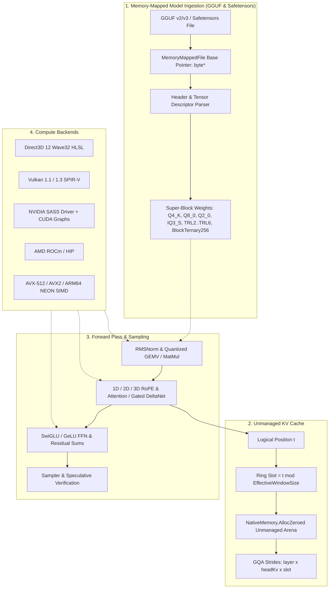

# Glacier.Inference Architecture

`Glacier.Inference` targets `.NET 10` (with Native AOT support and `<TreatWarningsAsErrors>true</TreatWarningsAsErrors>`) and runs autoregressive transformers, multimodal embedding encoders, and diffusion pipelines using unmanaged memory (`NativeMemory.AllocZeroed`) plus direct operating system driver P/Invoke (`nvcuda.dll` / `libcuda.so.1`, `d3d12.dll`, `vulkan-1.dll` / `libvulkan.so.1`, `amdhip64.dll`).

## System Context & Data Flow

## Subsystems

### 1. Memory-Mapped Storage & Quantization (`Gguf/`, `Format/`, `Quant/`)
- **`GgufFile` & `SafetensorsFile`:** Map model weight files directly via `MemoryMappedFile` so tensor lookups slice raw unmanaged pointers (`byte*`) without copying multi-gigabyte weight payloads onto the managed GC heap. Cleanup paths call `SafeMemoryMappedViewHandle.ReleasePointer()` under narrowed disposal exception handlers (`ObjectDisposedException` / `InvalidOperationException`).
- **Quantization Block Formats (`BlockTypes` / `QuantKernels`):**
  - `BlockQ8_0`: 32 elements in 34 bytes (FP16 scale + 32 signed 8-bit ints).
  - `BlockQ4_K`: 256 elements in 144 bytes (4.50 bits/weight).
  - `BlockQ6_K`: 256 elements in 210 bytes (6.56 bits/weight).
  - `BlockQ2_0`: 64 elements in 20 bytes (2.50 bits/weight), 4-byte aligned for Direct3D 12 coalesced loads.
  - `BlockIQ3_S`: 256 elements in 110 bytes (3.44 bits/weight) with codebook indexing.
  - `BlockTernary256`: 256 elements in 68 bytes for 1.58-bit BitNet models.
  - `TRL1..TRL6` (`NariQ` trellis quantization) via `TrellisKernels` and GPU decode kernels (`Qwen35CudaModel` / `NariQ`).

### 2. Unmanaged KV Cache (`Memory/KVCache.cs`)
Key and Value states live in contiguous unmanaged arenas allocated via `NativeMemory.AllocZeroed((nuint)totalBytes)` indexed by `(layer * layerStride) + (head * headStride) + (slot * slotStride)`. When ring-buffer or sliding-window mode is active, logical sequence positions wrap modulo `EffectiveWindowSize` so long sessions stay within a fixed memory budget.

### 3. Hardware Abstraction Layer (`Hardware/`, `Gpu/`)
- **`CuDriver` & `Qwen2GpuModel` / `Qwen35CudaModel`:** Direct P/Invoke bindings to `nvcuda.dll` / `libcuda.so.1` launching embedded cubin/PTX kernels and CUDA Graph capture for lower kernel-launch overhead.
- **`D3D12ComputeEngine`:** Direct3D 12 compute pipelines using HLSL Wave32 shaders, descriptor heaps, and disk-cached shader bytecode (falling back cleanly to recompilation if disk cache reads fail).
- **`HipDriver`:** Direct bindings to `amdhip64.dll` / `libamdhip64.so` / `/dev/kfd` on AMD hardware.
- **`VulkanContext` & `Qwen35VulkanModel`:** Direct bindings to `vulkan-1.dll` / `libvulkan.so.1` dispatching embedded SPIR-V kernels from a pre-built operation plan per token. On non-Windows hosts for hybrid Qwen 3.5/3.6 models with `Q4_K`/`Q5_K`/`Q6_K`/`Q8_0` weights, `InferenceSession` selects `Qwen35VulkanModel`; other models or unsupported weight types fall back cleanly to CPU SIMD. Full details are documented in [VULKAN_BACKEND.md](VULKAN_BACKEND.md).
- **`MultiGpu` Pipeline Splitting (`--split`):** Places transformer layers `0..K-1` on one accelerator and `K..L-1` on another, transferring hidden states through pinned unmanaged memory.

### 4. Speculative Decoding, Sampling & Diffusion Media
- **`SpeculativeEngine` & `PromptLookupDraftProvider`:** Proposes candidate draft tokens from prompt/context matches and verifies them in a batched target pass.
- **`Sampler`:** Single-pass greedy argmax (`0 B` managed allocation) and temperature / Top-K / Top-P / repetition-penalty sampling using stack-allocated candidate heaps for `K <= 128`.
- **Diffusion Pipelines (`FLUX.1` & `Wan 2.1`):** Flow-matching Euler ODE solvers coupled with tiled VAE decoding (splitting high-resolution image latents into overlapping `544x544` tiles with linear feather blending) and 3D causal VAE output (`APNG`, `GIF`, `AVI`).

## Windows TDR Safety & Memory Placement Constraints

- **Windows Display Driver Watchdog (TDR):** Display GPUs terminate single compute dispatches exceeding ~2 seconds (`DXGI_ERROR_DEVICE_RESET`). Cooperative Direct3D 12 prefill chunks prompts into bounded 32-token micro-batches, and display-attached cards default away from long un-preempted SASS passes unless selected explicitly.
- **Unified Memory Carve-Out on APUs:** On integrated Radeon 890M GPUs (Linux RADV), only the BIOS frame-buffer carve-out streams at full carve-out speed (~85 GB/s), whereas larger allocations spill into GTT (~16–30 GB/s). Prioritizing heavily read buffers such as the output head and re-quantizing dense projections helps keep active working sets inside the faster pool. See [VULKAN_BACKEND.md](VULKAN_BACKEND.md) for measurements.

## Core Design Decisions

1. **Direct OS Driver P/Invoke over C++ Wrapper Libraries:** Binding directly to `nvcuda.dll`, `d3d12.dll`, and Vulkan avoids bundling multi-gigabyte CUDA/ROCm toolkits inside application installers, at the cost of maintaining ABI tests against driver updates.
2. **Unmanaged Buffers for Hot Paths:** Using `NativeMemory` spans eliminates Gen0/1/2 heap churn during matrix-vector decode (`SimdDotBenchmarks` records 0 B managed allocation across all dot-product and RMSNorm paths).
3. **Standalone Embedded SPIR-V Vulkan Runner:** Shipping pre-compiled SPIR-V resources avoids runtime GLSL compiler dependencies on Linux and Android while keeping `Qwen35VulkanModel` free of optional Vulkan extensions.
